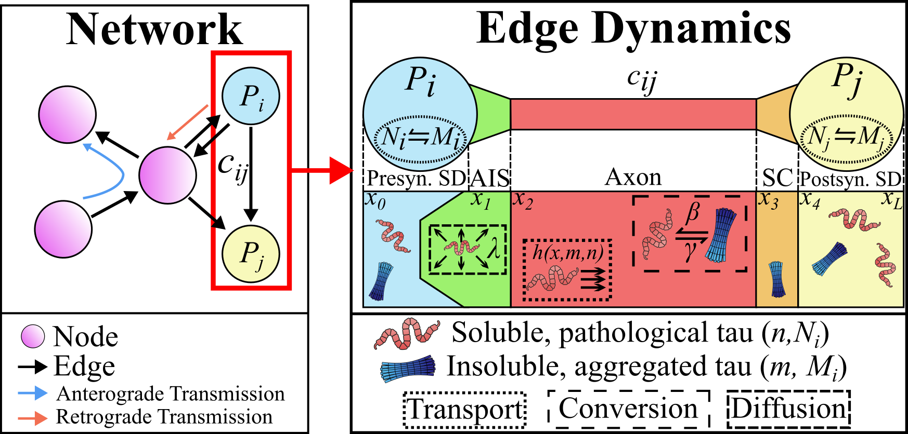
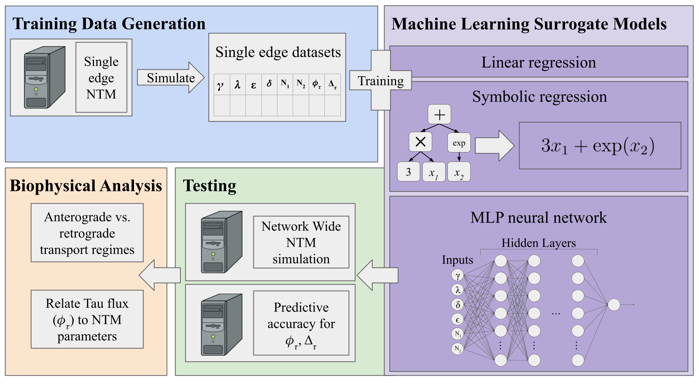
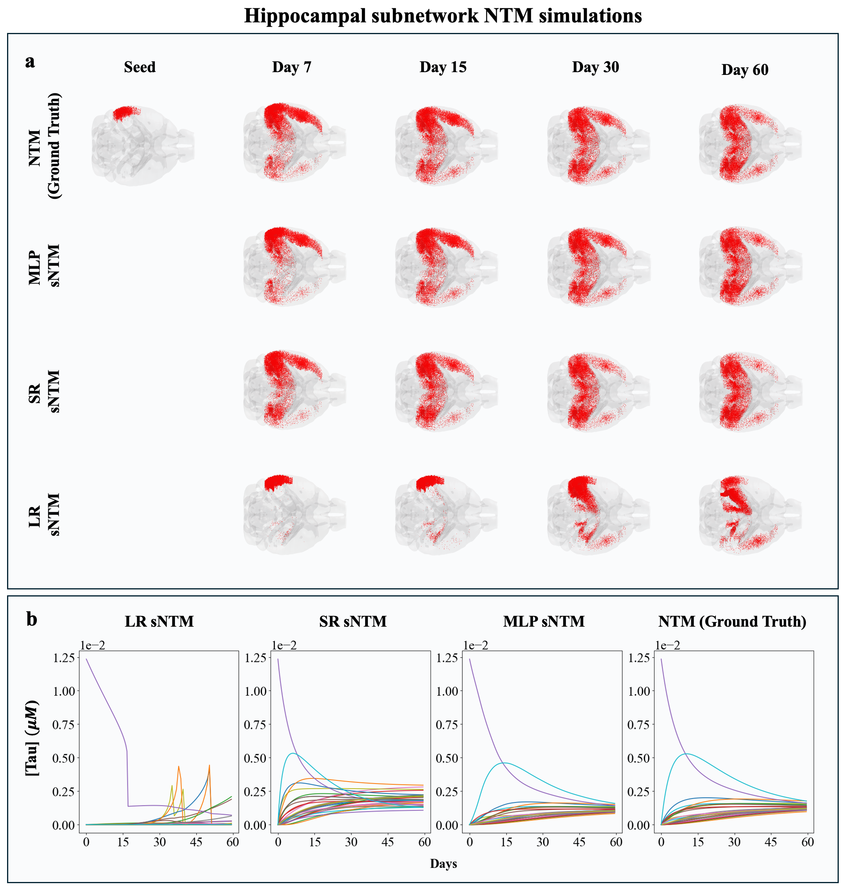
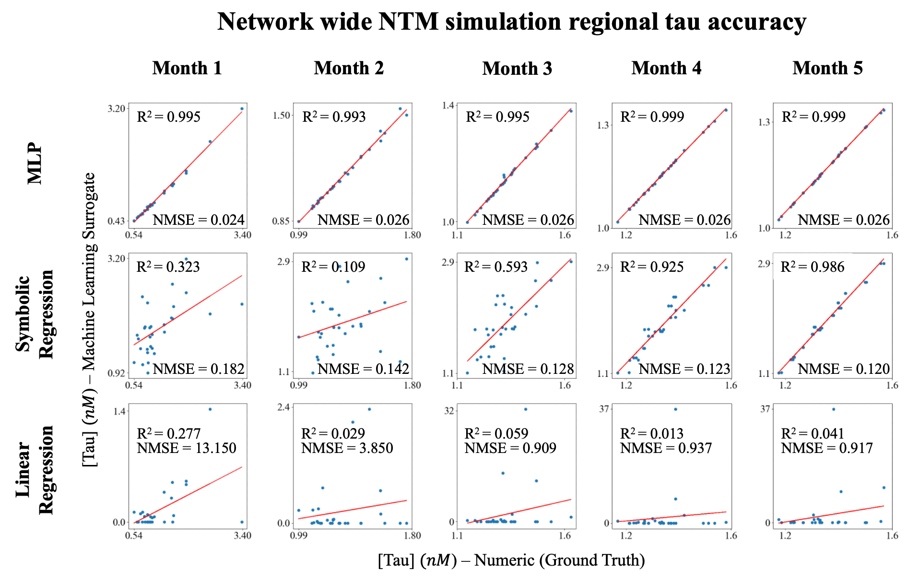

> **This paper is currently under review and revision.** Code, data and results in this
> repository may change until the revision is complete.

# NTM Surrogate Models

Machine-learning surrogates that speed up simulations of the **Network Transport Model (NTM)**
of tau protein spread in the brain.

The NTM simulates tau moving between brain regions (the nodes of the structural connectome)
along white-matter tracts (its edges). At every time step and on every edge, the numeric NTM
solves a boundary-value problem for two quantities:

- **φ_τ**, the tau flux along the edge;
- **Δ_τ**, the edge mass correction.

These solves take most of the simulation time. This repository trains models that predict
φ_τ and Δ_τ directly from six inputs: the parameters γ, λ, δ and ε, and the concentrations
N₁ and N₂ at the two ends of the edge. It then plugs these models into the network simulation
in place of the solver. The result is the **surrogate NTM (sNTM)**.

Four kinds of surrogate are compared:

- linear regression (LR);
- symbolic regression with PySR (SR);
- multilayer perceptrons (MLP);
- a Gaussian process (GP).

<p align="center">
  
</p>
<p align="center"><em>The Network Transport Model. Each edge is a two-neuron, multi-compartment system;
the surrogates replace the steady-state solve on every edge.</em></p>

## Contents

- [How it fits together](#how-it-fits-together)
- [Results at a glance](#results-at-a-glance)
- [Repository layout](#repository-layout)
- [Requirements](#requirements)
- [Getting started](#getting-started)
- [Data format](#data-format)
- [Reproducing the figures](#reproducing-the-figures)

## How it fits together

<p align="center">
  
</p>

1. **Generate training data.** Run the numeric single-edge NTM at sampled values of
   (γ, λ, δ, ε, N₁, N₂) and record φ_τ and Δ_τ.
2. **Train surrogates** on those samples (LR, SR, MLP, GP).
3. **Test them**:
   - on held-out single-edge data;
   - inside full network simulations of the 30-region hippocampal subnetwork of the mouse
     connectome, against the numeric NTM.
4. **Analyse** what drives tau flux (feature importance), and compare anterograde and
   retrograde transport regimes with the fast surrogate.

## Results at a glance

<p align="center">
  
</p>
<p align="center"><em>Tau spread from a seed region in the numeric NTM and in each sNTM: glass brains (a)
and regional concentration over the first 60 days (b).</em></p>

<p align="center">
  
</p>
<p align="center"><em>Regional tau of each sNTM against the numeric NTM at months 1–5.</em></p>

## Repository layout

| Folder | What it contains |
|---|---|
| `data/` | Single-edge training and validation data. The MLP data (11 files of 10⁵ samples) are in `data_neural_network_model/training_data_e6/`; the LR and SR data are in `data_baseline_models/`. |
| `mlp_training/` | MLP architecture, hyperparameter grid search with 10-fold cross-validation, SHAP analysis, and the Docker files used for training. |
| `linear_regression/` | LR variants (linear, quadratic, interaction, all terms), forward feature selection and feature-importance tests (Jupyter). |
| `Symbolic_Regression/` | PySR training script and error and plotting utilities (see `readme_pysr_runmodes.md`). |
| `gaussian_process-interpolant/` | GP and scattered-data interpolant fits and their comparison tables (MATLAB). |
| `griddatan/` | `griddatan` interpolation baseline, compared with the GP (has its own `README.md`). |
| `network_validation/` | Network simulations with each surrogate, the cluster scripts that run them, and the analyses for the revision. Details below. |
| `parameter_recovery/` | Synthetic single-edge parameter recovery with each surrogate (`locked_edge/` makes the fixed-parameter test datasets). |
| `visualizations/` | Notebooks that draw the paper's figures. |
| `docs/figures/` | Figures used in this README. |

### `network_validation/` in more detail

| File(s) | Purpose |
|---|---|
| `sntm_config.m` | Paths and fixed simulation settings for every run (override with environment variables, below). |
| `make_surrogate.m`, `mlp_forward.m` | Wrap each surrogate as a function the simulator calls instead of its numeric solver. |
| `models/` | Model files used in the simulations: MLP weights, compact GP model, LR coefficients. |
| `run_sntm_cases.m`, `run_local.m`, `run_cases.slurm` | Run the rows of a manifest (`manifests/*.csv`), on a PC or as a SLURM array. |
| `network_checks_l2f.m`, `plot_fig_sy.m` | Network accuracy, stability and non-negativity of each surrogate over several parameter settings and seed regions. |
| `edge_inputs_l2f.m`, `gp_trajectory_l2f.m`, `mass_balance_l2f.m`, `single_edge_error_locked.m` | Training-data coverage, GP predictive variance, mass balance, and accuracy at and beyond the training ranges. |
| `timing_table3.m` | Run-time table from repeated timing runs. |
| `nelder_mead_network_recovery.m` and related | Network-level parameter recovery experiments. |
| `solver_check/` | Diagnosis of the numeric network flux solver. |
| `results/` | CSV results and dated logs (`RESULTS_*.md`) with the commands that regenerate them. |
| `CHECKING.md` | How to check cluster runs, copy them back, and compare runs. |

## Requirements

**Python** (MLP training, LR, SR, figures): Python 3 with the packages in
`mlp_training/requirements.txt` (PyTorch, scikit-learn, pandas, SHAP and others). SR also
needs [PySR](https://github.com/MilesCranmer/PySR).

**MATLAB** (GP, network simulations, analyses): the network scripts have been run with
MATLAB R2022b and R2026a. They use the Optimization Toolbox (`fsolve`) and the
Statistics and Machine Learning Toolbox (GP). `run_local.m` also uses the Parallel Computing
Toolbox.

**NTM simulator:** the network simulations call the NTM code
(`NetworkTransportModel.m` and its helpers). This code is **not** in this repository. Point the
scripts at your copy with the `NTM_SIM_ROOT` environment variable (see below).

## Getting started

### Train the MLPs (Docker)

```bash
cd mlp_training
# copy the training CSVs from data/data_neural_network_model/training_data_e6/
# into mlp_training/training_data/ first
docker build -t ntm-mlp .
./run_container.sh
```

### Fit the linear regressions

Run `linear_regression/classical_regressions.ipynb`, then
`feature_selection_and_importance.ipynb`, in Jupyter.

### Run network simulations (MATLAB)

From `network_validation/`:

```matlab
% where the NTM simulator lives, and where outputs go
setenv('NTM_SIM_ROOT', 'C:\path\to\Tau_Transport');      % folder with Code/ and MatFiles/
setenv('SNTM_OUT_DIR', fullfile(pwd, 'outputs'));

% run every case of a manifest on this machine (finished cases are skipped)
run_local('manifests/surrogate.csv', 4)
```

Each manifest row names the method (`numeric`, `mlp`, `sr`, `gp`, `lr`), the parameters
and the seed region. Each case writes one `.mat` file holding the regional concentrations
`N`, the edge fluxes `F`, the edge mass correction `W1`, the run time, and the settings used.

Other environment variables:

| Variable | Effect |
|---|---|
| `SNTM_SMOKE=1` | A few time steps only, for a quick test of the pipeline. |
| `SNTM_T_END` | Stop at this day. |
| `SNTM_DT_MAX` | Cap the time step (days). |
| `SNTM_RELTOL`, `SNTM_ABSTOL` | ODE tolerances. |

On a SLURM cluster, `run_cases.slurm` runs a manifest as an array job. Its header lists
example commands. `CHECKING.md` explains how to check the results.

### Reproduce the revision analyses

Each analysis script writes its results to `network_validation/results/`. The
`RESULTS_*.md` files there list the commands that regenerate every number. For example:

```matlab
network_checks_l2f();   % network accuracy over 8 settings x 3 seeds
plot_fig_sy();          % the accompanying figure
timing_table3();        % run-time table from the repeated timing runs
```

## Data format

All single-edge CSVs share these columns:

```
gamma1, lambda1, delta, epsilon, NRow, NCol, FValue, W1
```

- `gamma1`–`NCol`: the six inputs (γ, λ, δ, ε, N₁, N₂);
- `FValue`: tau flux φ_τ (target);
- `W1`: edge mass correction Δ_τ (target).

## Reproducing the figures

Notebooks in `visualizations/` draw the paper's figures. Each expects its input files in
`visualizations/data/`.

| Notebook | Figure |
|---|---|
| `figure4_regression_graph.ipynb` | LR forward feature selection |
| `figure6_nn_heatmaps.ipynb` | MLP hyperparameter search |
| `figure8b_figure11_network_sim.ipynb` | Regional tau curves and accuracy scatter plots |
| `figure9_bio_figure.ipynb` | Anterograde vs. retrograde transport regimes |
| `figure10_shapley.ipynb` | MLP SHAP feature importance |

The glass-brain images are made with [Brainframe](https://github.com/Raj-Lab-UCSF/Brainframe).
